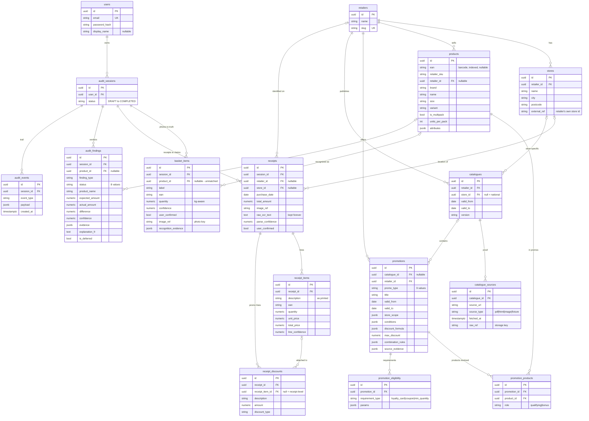

# Database Schema — Grocery Receipt Auditor

Source of truth: `backend/app/models/`. This diagram mirrors the ORM models —
update it whenever the models change. Renders as a diagram on GitHub (Mermaid).

## Conventions

- All PKs: `uuid`. Timestamped tables carry `created_at`/`updated_at` (mixin);
  append-only records (`*_items`, `*_discounts`, `catalogue_sources`,
  `promotion_*`, `audit_events`) carry `created_at` only.
- All money: `numeric(10,2)` — never float.
- `||--o{` = one-to-many, `|o--o{` = optional-one to many.
- Nullable FKs mark "not yet identified" (AI extraction) — never fabricate.
- JSONB columns hold irregular domain data (promo rules, evidence); validated
  by the deterministic engines, not the schema.
